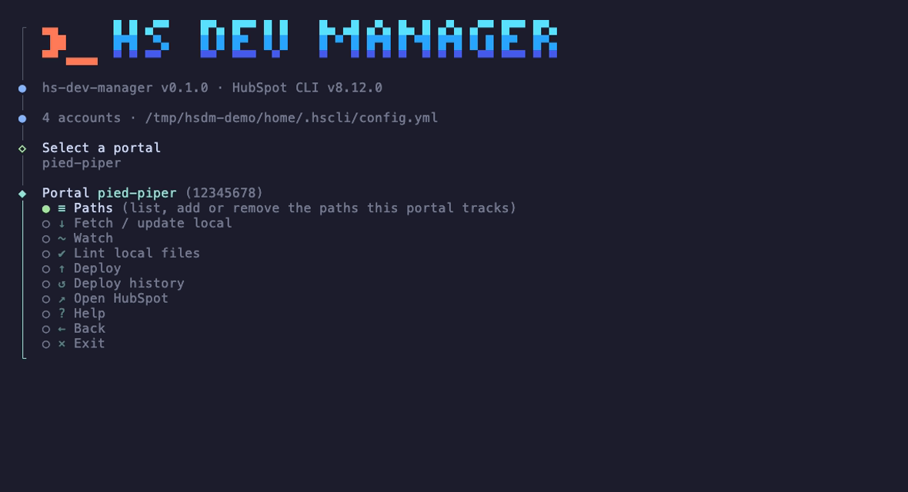
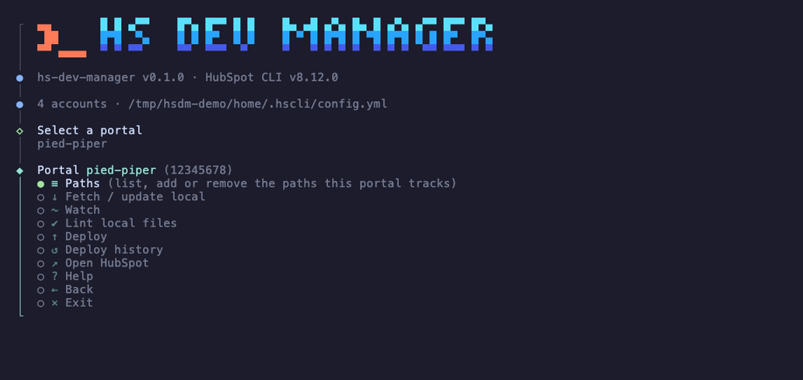
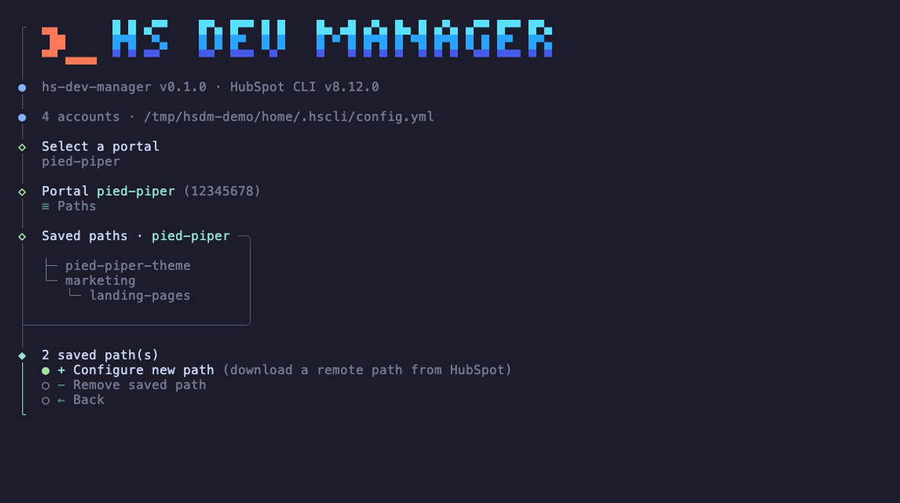
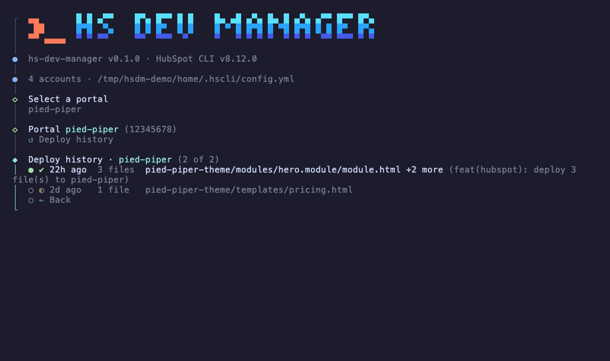

<p align="center">
  
</p>

[](https://github.com/robstermarinho/hs-dev-manager/actions/workflows/ci.yml)
[](https://www.npmjs.com/package/hs-dev-manager)
[](https://nodejs.org)
[](./LICENSE)

Interactive CLI for fetching, watching, and deploying HubSpot Design Manager files across multiple accounts.

> **Not an official HubSpot product.** This project is not affiliated with, endorsed by, or supported by HubSpot, Inc. It is a community tool that wraps the official [HubSpot CLI](https://www.npmjs.com/package/@hubspot/cli). "HubSpot" is a trademark of HubSpot, Inc., used here only to describe compatibility.

## Why this package?

The official `hs` CLI is a fine tool, genuinely. But it was clearly designed with one portal in mind, and some of us live a different life: five client portals before lunch, each with its own Design Manager tree, and a strong desire not to `hs account use` our way into deploying the wrong theme to the wrong customer.

That's the gap this tool fills. While we wait, in the spirit of "no rush, HubSpot, we know you're busy," `hsdm` gives you:

- **Portals as a first-class concept:** Pick an account from a menu, and every fetch, watch, and deploy is scoped to it. Files land in `src/{account}-{id}/`, so two portals never collide.
- **Saved remote paths per portal:** Configure a Design Manager path once, reuse it forever. No more retyping `/Marketing/Themes/...` from memory.
- **Guardrails around destructive syncs:** Fetch refuses to overwrite uncommitted work, and every clean sync becomes a scoped Git commit. Your history knows exactly what came from where.
- **A deploy flow that asks first:** Pick the changed files to upload, get a commit containing only what actually shipped.
- **Portal-scoped HubSpot shortcuts:** Open Design Manager, website pages, HubDB, settings, or files for the selected portal.
- **One menu instead of seven flags:** Arrow keys, not man pages.

If you manage a single portal, the official CLI is probably all you need. If you manage several, this is the tool we wished existed, so we built it.

## Requirements

- Node.js 22 or newer
- HubSpot CLI 8.x
- At least one authenticated HubSpot account
- Git for deploy detection and automatic sync commits

## Get started

From nothing to a first deploy. Steps 1 and 2 are one-time setup for the machine.

**1. Install the HubSpot CLI and authenticate an account**

```bash
npm install --global @hubspot/cli
hs account auth
```

**2. Install this tool**

```bash
npm install --global hs-dev-manager
```

**3. Prepare a folder for the HubSpot files**

```bash
mkdir my-hubspot-site && cd my-hubspot-site
hsdm init
```

`hsdm init` creates a Git repository (deploy and sync commits need one) and a `.gitignore` for the tool's local state. It is safe to re-run, and it never touches rules you already have. Skipping it is fine too: the menu offers the same thing the first time it matters.

**4. Download a Design Manager path**

```bash
hsdm
```

Pick your account, then **Paths → Configure new path**. Browse the Design Manager or type a path such as `/my-theme`. Files land under `src/{account-name}-{account-id}/`.

**5. Edit locally, then send the changes back**

Edit the downloaded files with your own editor, then from the menu:

- **Watch** uploads each file as you save it — best for iterating on styles and templates.
- **Deploy** lets you pick which changed files to upload, checks them against HubSpot first, and records a scoped Git commit.

**6. Come back later**

Open `hsdm` and choose **Fetch / update local**. It reports what changed in the Design Manager since your last sync — someone editing there is the normal case — and lets you download only what moved, or the whole path.

### What gets tracked

| Path | Commit it? |
| --- | --- |
| `src/{account}-{id}/` | yes — the HubSpot files themselves |
| `paths-config.json` | yes — which remote paths the project tracks, shared with the team |
| `db/`, `.hsaccount` | no — local sync state and your last selected account (`hsdm init` ignores them) |

## What it looks like

Every session starts by picking the portal you are about to touch, so "which account am I on?" stops being a question you answer from memory:

<p align="center">
  
</p>

From there, every action is scoped to that portal until you switch:

<p align="center">
  
</p>

Entering `Paths` shows what the portal tracks before offering to add or remove anything:

<p align="center">
  
</p>

Past deploys are browsable, with relative ages and the files each one carried:

<p align="center">
  
</p>

Account names and IDs above are fictional.

## Safety behavior

- Fetch operations use HubSpot's `--overwrite` option and are blocked when the selected account's local scope contains uncommitted changes.
- An incomplete fetch is never committed automatically. Any partially written files remain uncommitted for inspection.
- Deploy uploads only the files selected in the prompt and commits only successfully uploaded files.
- Locally deleted files are reported but are not deleted remotely.
- Adding an account delegates authentication to the official `hs account auth` flow. This package does not collect credentials.

Use a HubSpot sandbox or test account when validating a new workflow. `Watch` and `Deploy` write to the selected HubSpot account.

## Network use

Every HubSpot request goes through the official CLI (`hs`) and your existing personal access key. No separate credentials, no third-party service, no telemetry.

Nothing is requested until you ask for it: opening the menu makes no calls at all.

| When | Requests | Writes to HubSpot? |
| --- | --- | --- |
| Entering `Fetch / update local`, or starting a `Watch` | 2 (`hs api`, listing paths and modification times) | No |
| Deploy, before uploading | 2 (the same listing), plus 1 download per selected file whose remote copy changed since your last sync | No |
| Fetch, watch, deploy uploads | Whatever `hs cms fetch` / `watch` / `upload` need | Uploads only |
| Lint, diff, deploy history | 0 | No |

Entering `Fetch / update local` lists exactly what moved on HubSpot, with a per-path summary next to each saved path. Picking a path that drifted then asks how to update it: `Only what changed` downloads just that path's drifted assets, `Full re-download` fetches the whole path as before. Each saved path is treated on its own, so drift in one project never pulls another one down with it. The check is read-only and stays silent when it fails (for example when your access key lacks the required scopes) — it never claims your copy is current without knowing.

`Watch` runs the same check before it starts, since watching uploads local edits: if nothing moved on HubSpot it goes straight to watching, and otherwise it offers to download what changed, re-download the whole path, or watch anyway.

Deploy uses the same listing to decide which files actually need comparing: a file whose remote copy has not moved since your last sync is not downloaded at all. Anything the listing does not cover falls back to a per-folder listing and a download, so coverage gaps never turn into a silent overwrite.

To skip every remote check — in CI, or with an access key that lacks the scopes:

```bash
HSDM_NO_REMOTE_CHECK=1 hsdm
```

Deploy then uploads without comparing against HubSpot, so edits made there are overwritten silently. It says so before uploading.

## Local files

| Path | Purpose |
| --- | --- |
| `src/{account}-{id}/` | Files downloaded from Design Manager |
| `paths-config.json` | Saved remote paths by account |
| `.hsaccount` | Last selected account ID |
| `db/fetch-log.json` | Successful fetch timestamps |
| `db/deploy-history.json` | Most recent 50 deploy records |
| `db/remote-state.json` | Content hash of each file at its last sync, used to detect edits made in Design Manager |

`src/{account}-{id}/`, `paths-config.json`, `.hsaccount`, `db/fetch-log.json` and `db/deploy-history.json` remain compatible with the legacy shell-based workflow.

## Development

```bash
npm install
npm run check
npm run test:coverage
npm pack --dry-run
```

Useful scripts:

- `npm run dev`: Rebuild on source changes
- `npm run lint`: Run ESLint
- `npm run typecheck`: Run TypeScript without emitting files
- `npm test`: Run the Vitest suite once
- `npm run build`: Build the Node 22 ESM bundle in `dist/`

## License

MIT © 2026 Robert Marinho
